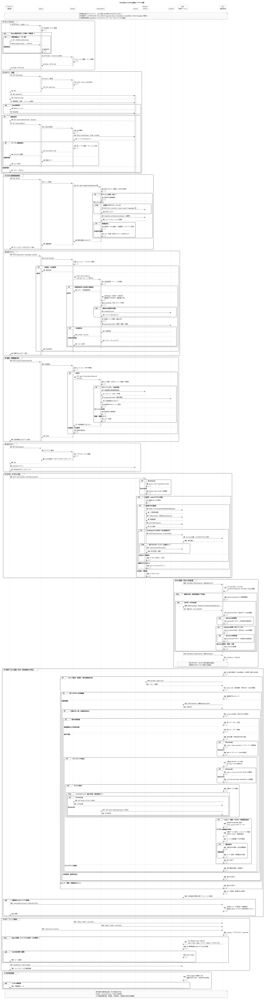
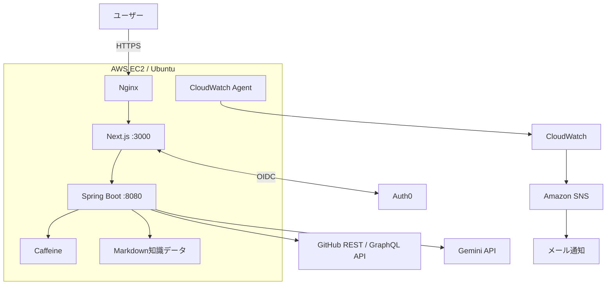
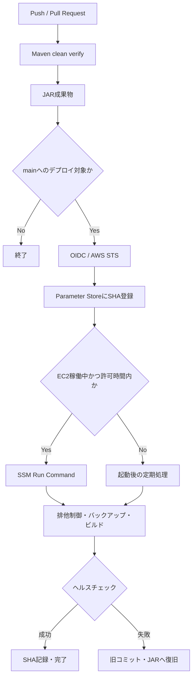

# Portfolio Backend

Java 21 / Maven / Spring Boot 3.5.7 を使用したポートフォリオサイトのバックエンド。
GitHub APIによる開発状況の可視化、Google Gemini APIによるAIチャット、RAGによる知識参照、週間・月間の開発進捗分析を提供する。

## 公開環境

- フロントエンド: https://toyohashi-portfolio.duckdns.org
- 稼働予定時間: 毎日 08:00〜20:00（JST）
- バックエンドはEC2内部のループバックアドレス（127.0.0.1:8080）で稼働し、外部へ直接公開しない。
- 
## システム全体シーケンス図

<details>
<summary>シーケンス図を表示する</summary>



</details>

## 技術スタック

| 分類 | 技術 | 用途 |
|---|---|---|
| 開発言語 | Java 21 | バックエンド実装 |
| フレームワーク | Spring Boot 3.5.7 / Spring Web | REST API |
| ビルド | Maven | 依存関係・ビルド管理 |
| HTTP通信 | Spring RestClient | 外部API通信 |
| JSON | Jackson | JSON変換 |
| キャッシュ | Spring Cache / Caffeine | GitHub APIキャッシュ |
| 外部API | GitHub REST API / GraphQL API | 開発実績・進捗取得 |
| 生成AI | Google Gemini API | チャット・進捗分析 |
| AI検索 | Gemini Embedding / RAG | 知識検索 |
| 認証連携 | Auth0 / OAuth 2.0 / OpenID Connect | Next.js側の認証 |
| テスト基盤 | Spring Boot Starter Test | テスト環境 |
| フロントエンド | Next.js / TypeScript / Tailwind CSS | UI・サーバー側API連携 |
| OS | Ubuntu Server 24.04 LTS | 本番実行環境 |
| Webサーバー | Nginx | リバースプロキシ |
| DNS | DuckDNS | ドメイン管理 |
| TLS | Let's Encrypt / Certbot | HTTPS |
| プロセス管理 | systemd | サービス起動・定期処理 |
| ログ管理 | rsyslog / logrotate | ログ振り分け・世代管理 |
| デプロイ制御 | Bash / flock | 排他制御・復旧 |
| CI/CD | GitHub Actions | ビルド・自動デプロイ |
| バージョン管理 | Git / GitHub | ソース・Issue管理 |

### AWS技術スタック

| 分類 | サービス・機能 | 用途 |
|---|---|---|
| コンピューティング | Amazon EC2 | アプリケーション実行 |
| ストレージ | Amazon EBS (gp3) | 永続ストレージ |
| ネットワーク | Amazon VPC | 仮想ネットワーク |
| ネットワーク | Elastic IP | 固定IPv4アドレス |
| ネットワーク | Security Groups | 通信制御 |
| 認証・認可 | AWS IAM | ロール・ポリシー・OIDCプロバイダー |
| 一時認証情報 | AWS STS | GitHub Actionsの一時認証 |
| 運用管理 | AWS Systems Manager | マネージドノード管理・Run Command |
| 設定管理 | Systems Manager Parameter Store | デプロイ対象SHAの管理 |
| スケジュール | Amazon EventBridge Scheduler | EC2自動起動・停止 |
| メトリクス | Amazon CloudWatch Metrics | リソース監視 |
| ログ | Amazon CloudWatch Logs | ログ収集 |
| ログ分析 | CloudWatch Logs Insights | ログ検索 |
| 異常検知 | Amazon CloudWatch Alarms | しきい値監視 |
| 可視化 | Amazon CloudWatch Dashboards | 監視画面 |
| エージェント | Amazon CloudWatch Agent | OSメトリクス・ログ転送 |
| 通知 | Amazon SNS | メール通知 |
| コスト管理 | AWS Budgets | 予算通知 |
| 請求管理 | AWS Billing and Cost Management | 利用料金管理 |
| 操作ツール | AWS CLI | AWS API操作 |

## 機能一覧

### GitHub連携

- [x] 公開リポジトリ情報取得（許可リスト方式）
- [x] コミット・Issue・Pull Request情報取得
- [x] 使用言語・最新リリース情報取得
- [x] GraphQLによるコントリビューション取得
- [x] 開発状況ダッシュボードAPI
- [x] ページネーション・タイムアウト・キャッシュ

### AI Assistant

- [x] Gemini APIによるチャット
- [x] 会話履歴をリクエストに含めた文脈管理
- [x] Markdown知識データを利用したRAG
- [x] 回答の参照元返却
- [x] 週間・月間開発進捗分析
- [x] AI APIアクセスキー検証
- [x] リクエスト回数制限・分析キャッシュ
- [ ] チャット履歴のDB保存
- [ ] ストリーミング応答
- [ ] ユーザー別利用量管理
- [ ] 定期分析の自動実行

### 今後の機能

- [ ] MySQL・Spring Data JPA・Flyway
- [ ] Spring Security / Auth0 JWT検証
- [ ] ユーザー管理・RBAC
- [ ] お問い合わせ保存・メール送信
- [ ] ブログCRUD API
- [ ] 管理者API
- [ ] プロフィール・制作実績・スキル管理API
- [ ] OpenAPI仕様書・ER図
- [ ] 単体・結合・セキュリティテストの拡充

## システム構成



現在はデータベース不要の構成。Auth0の認証はNext.js側で行い、AI APIにはサーバー間のアクセスキーを使用する。Spring Boot側のJWT検証・ユーザー単位の認可は今後実装する。

## ディレクトリ構成（主要部分）

```text
portfolio-backend/
├── .github/workflows/
├── src/main/java/com/portfolio/
│   ├── github/
│   │   ├── PortfolioApplication.java
│   │   ├── GithubController.java
│   │   ├── GithubService.java
│   │   └── GithubClient.java
│   └── ai/
│       ├── client/
│       ├── config/
│       ├── controller/
│       ├── dto/
│       └── service/
├── src/main/resources/
│   ├── application.yml
│   └── knowledge/
│       ├── profile.md
│       └── projects.md
├── pom.xml
└── README.md
```

## ローカル開発環境

### 前提条件

- JDK 21
- Maven
- Git
- GitHubアカウント（トークンは必要に応じて発行）
- Gemini APIキー（AI機能利用時）

```powershell
git clone https://github.com/makoto-toyohashi/portfolio-backend.git
cd portfolio-backend
java -version
mvn -version
```

### 環境変数

| 変数 | 用途 |
|---|---|
| SERVER_PORT | HTTPポート（8080） |
| SERVER_ADDRESS | バインドアドレス |
| GITHUB_OWNER | GitHubオーナー |
| GITHUB_REPOSITORIES | 許可するリポジトリのカンマ区切り一覧 |
| GITHUB_TOKEN | GitHub APIトークン（必要に応じて設定） |
| GEMINI_ENABLED | AI機能の有効化 |
| GEMINI_API_KEY | Gemini APIキー |
| GEMINI_PROJECT_ID | GCPプロジェクトID（必要時） |
| GEMINI_PROJECT_NUMBER | GCPプロジェクト番号（必要時） |
| GEMINI_MODEL | 生成モデル |
| GEMINI_EMBEDDING_MODEL | 埋め込みモデル |
| AI_ACCESS_KEY | Next.jsとのサーバー間認証キー |

PowerShell設定例（値はすべて例示）:

```powershell
$env:SERVER_PORT="8080"
$env:SERVER_ADDRESS="127.0.0.1"
$env:GITHUB_OWNER="makoto-toyohashi"
$env:GITHUB_REPOSITORIES="portfolio-frontend,portfolio-backend"
$env:GITHUB_TOKEN="your-github-token"
$env:GEMINI_ENABLED="true"
$env:GEMINI_API_KEY="your-gemini-api-key"
$env:GEMINI_MODEL="gemini-3.1-flash-lite"
$env:GEMINI_EMBEDDING_MODEL="gemini-embedding-001"
$env:AI_ACCESS_KEY="your-shared-ai-access-key"
mvn spring-boot:run
```

AI_ACCESS_KEYはFrontend側と一致させる。AI機能を使用しない場合はGEMINI_ENABLED=falseとする。Spring Bootは通常の.envファイルを自動では読み込まない。実際のキーをREADMEやGitに登録しないこと。

### ビルド・品質チェック

```bash
mvn clean verify
mvn clean package
java -jar target/portfolio-backend-0.0.1-SNAPSHOT.jar
```

## API仕様

ベースURL（ローカル）: `http://localhost:8080/api/v1`

### GitHub API

| Method | Path | 内容 |
|---|---|---|
| GET | /github/projects | リポジトリ一覧 |
| GET | /github/projects/{name}/progress | リポジトリ進捗 |
| GET | /github/contributions | コントリビューション |
| GET | /github/dashboard | 開発状況集約 |

- 許可リストに含まれる公開リポジトリのみを対象とする。
- GitHubトークンには必要最小限の読み取り権限を付与する。
- キャッシュ期間は5分。
- Issue進捗はPull Requestを除外し、not plannedを含む全Closed Issueを完了数として扱う。Issueがない場合は進捗率null。
- コミット集計はデフォルトブランチの直近30 UTC暦日、言語集計はバイト数、最新リリースはタグを扱う（初期仕様）。
- GitHub API用エンドポイント自体のユーザー認証・レート制限は今後の課題。

### AI API

| Method | Path | 内容 |
|---|---|---|
| POST | /ai/chat | AIチャット |
| GET | /ai/analysis/weekly | 週間進捗分析 |
| GET | /ai/analysis/monthly | 月間進捗分析 |

AI APIには `X-AI-Key` ヘッダーを使用する。

リクエスト例:

```json
{
  "message": "このポートフォリオの技術構成を教えてください",
  "history": []
}
```

レスポンス形式の例:

```json
{
  "answer": "回答本文",
  "sources": ["projects.md"]
}
```

### AI設定の概要

| 項目 | 設定値 |
|---|---|
| 質問文字数上限 | 1000文字 |
| 会話履歴 | 最大6件 |
| RAGチャンクサイズ / オーバーラップ | 500 / 100 |
| RAG取得件数 | 上位3件 |
| 生成温度 | 0.3 |
| 最大出力トークン | 1024 |
| 利用制限 | 3回/分・20回/24時間 |
| 分析キャッシュ | 6時間 |
| Gemini接続 / 読み取りタイムアウト | 10秒 / 60秒 |

設定値は構築時の仕様。最新のapplication.ymlおよび実装を優先する。現在の利用制限はユーザー別の永続的なクォータ管理ではない。

## CI/CD



- GitHub ActionsでJava 21によるビルド・検証・JAR成果物保存を実施。
- OIDCによる一時認証を利用し、長期AWSアクセスキーを使用しない。
- EC2停止中はデプロイを予約し、起動後に処理する。
- Frontend / Backend共通の排他ロックを使用する。
- JARバックアップ、ハッシュ検証、ヘルスチェック、ロールバックを実装。
- デプロイ対象SHAの検証、重複防止、最大3回の試行・15分間隔のリトライ制御を実装。
- デプロイ受付時間は08:00〜18:00未満（JST）。20時の停止までの完了を保証するものではない。

## AWS運用・監視

EC2は東京リージョン、t3.small、EBS gp3 20GiB、Swap 2GiBの構成。systemdでJava・Next.jsを管理する。

| 監視対象 | 設定概要 |
|---|---|
| CPU使用率 | 80%以上 |
| メモリ使用率 | 85%以上 |
| ディスク使用率 | 80%以上 |
| Swap使用率 | 80%以上 |
| CPUクレジット | 10以下 |
| EC2ステータスチェック | 異常検知 |
| ネットワーク | 通信量の可視化 |
| ログ | Frontend・Backend・Nginx・デプロイ |
| 料金 | AWS Budgetsによる月額30 USDの暫定予算通知 |

CloudWatch Logsの保持期間は14日。ローカルのアプリケーション・デプロイログはlogrotateで管理する。SNSによる通知とCloudWatch Dashboardを設定済み。予算は課金の強制上限ではない。

## セキュリティ・残作業

- HTTPS、Security Groups、ループバックバインドによる公開範囲制限。
- GitHub・Geminiの認証情報はサーバー側で管理する。
- 本番のBackend環境変数はアクセス権を制限した環境ファイルで管理する。
- Auth0セッションの確認はFrontend側で行う。Spring SecurityによるJWT検証・RBACは未実装。
- IAM最小権限化、認証情報の無効化確認、Nginxログの機密情報対策、EBS暗号化状態確認は継続課題。
- ログ収集経路のテスト、通常デプロイ・停止中の予約デプロイ、隔離環境でのロールバック試験を実施済み。
- 強制停止中の復旧、実際の通知、SSL自動更新、スケジュール実行、アプリケーション自身のログ出力などの詳細確認は残っている。
- EC2停止中や監視データ欠損時のアプリケーション可用性監視は未整備。

## タスク管理・関連リポジトリ

機能追加・AWS運用・テスト・設計書作成はGitHub Issuesで管理する。

- [Backend Issues](https://github.com/makoto-toyohashi/portfolio-backend/issues)
- [Portfolio Frontend](https://github.com/makoto-toyohashi/portfolio-frontend)
- [Portfolio Backend](https://github.com/makoto-toyohashi/portfolio-backend)

## 開発者

Makoto Toyohashi
